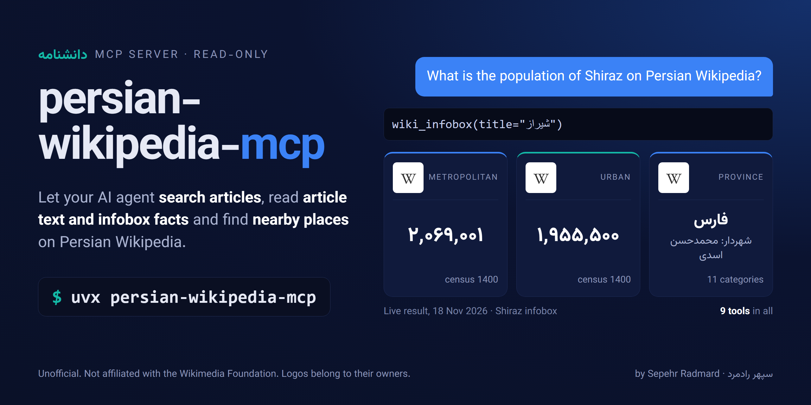

<!-- mcp-name: io.github.sepehr071/persian-wikipedia-mcp -->

<div align="center">



# persian-wikipedia-mcp: Persian Wikipedia (ویکی‌پدیای فارسی) MCP server for AI agents

**persian-wikipedia-mcp is an unofficial, read-only MCP server that lets an AI agent search articles, read summaries, full article text and infobox facts, and find nearby places on the Persian Wikipedia (ویکی‌پدیای فارسی, fa.wikipedia.org).**<br>
Its 9 tools search articles, give an article's lead summary, return the article as plain text (whole or one section, cut to a length limit), list its sections, read the infobox facts (birth date, population, ...) with categories, find the same article in other languages, pick a random article, show the most-read articles and the picture of the day, and find articles near a latitude and longitude.<br>
No API key or account is needed; it works in Claude, Cursor, Copilot and any other MCP client.

[](https://pypi.org/project/persian-wikipedia-mcp/)
[](https://pypi.org/project/persian-wikipedia-mcp/)
[](https://github.com/sepehr071/persian-wikipedia-mcp/actions/workflows/ci.yml)
[](https://github.com/sepehr071/persian-wikipedia-mcp/blob/main/LICENSE)

[For AI agents](#for-ai-agents) · [Quick start](#quick-start) · [Tools](#tools) · [Limits](#limits) · [فارسی](#فارسی)

</div>

---

## For AI agents

- **What:** unofficial MCP server (model context protocol) for fa.wikipedia.org: article search, lead summaries, plain-text article body by section, section lists, infobox facts and categories, other-language titles, random article, most-read articles and nearby places.
- **Install:** `uvx persian-wikipedia-mcp` or `claude mcp add persian-wikipedia -- uvx persian-wikipedia-mcp`. Transport: stdio. Needs [uv](https://docs.astral.sh/uv/getting-started/installation/) (Python 3.10+).
- **Auth:** none. Optional `PERSIAN_WIKIPEDIA_MCP_PROXY` (HTTP proxy URL, or a comma-separated list); system proxy settings are ignored.
- **Access:** read-only. It cannot log in or edit. It sends a descriptive User-Agent, as the Wikimedia User-Agent policy asks.
- **Tools:** 9, all prefixed `wiki_`. Typical sequences: `wiki_search` -> `wiki_summary`; `wiki_sections` -> `wiki_article` (one section); `wiki_infobox` for facts; `wiki_languages` for the English title; `wiki_nearby` for places around a point.
- **Use when:** the user asks what something or someone is, wants facts from an Iranian city, person or topic article (birth date, population, province), wants a section of an article, wants the English name of a Persian article, or asks what people are reading on the Persian Wikipedia.
- **Output:** compact JSON; article text is plain text with `== heading ==` lines. Text and titles are Persian, numbers in infoboxes keep Wikipedia's Persian digits.
- **Content license:** Wikipedia text is written by Wikipedia contributors and is available under CC BY-SA. Reuse needs attribution and the same license.

## Quick start

You need [uv](https://docs.astral.sh/uv/getting-started/installation/). No API key or account.

Claude Code:

```bash
claude mcp add persian-wikipedia -- uvx persian-wikipedia-mcp
```

Claude Desktop, Cursor, VS Code and other clients:

```json
{
  "mcpServers": {
    "persian-wikipedia": { "command": "uvx", "args": ["persian-wikipedia-mcp"] }
  }
}
```

Example prompts:

- "What is the English name of the Persian Wikipedia article about Shiraz?"
- "Read the history section of the Tehran article on Persian Wikipedia."
- "What are people reading most on Persian Wikipedia today?"
- <span dir="rtl">جمعیت شیراز طبق ویکی‌پدیای فارسی چقدر است؟</span>
- <span dir="rtl">چه مقاله‌هایی نزدیک میدان آزادی هست؟</span>

Real answer (18 Nov 2026): `wiki_infobox(title="شیراز")` returned the metropolitan population from the 1400 census as ۲٬۰۶۹٬۰۰۱ and the urban population as ۱٬۹۵۵٬۵۰۰, with the province Fars and 11 categories; `wiki_languages(title="شیراز", lang="en")` returned "Shiraz".

## Tools

| Tool | What it returns |
|---|---|
| `wiki_search` | Articles matching words (Persian or English): titles, snippet, word count, total hits, paged with `offset` |
| `wiki_summary` | Lead summary: one-line description, intro paragraph, image, coordinates, Wikidata id, URL |
| `wiki_article` | The article as plain text, optionally one section (with subsections), cut to `max_chars` |
| `wiki_sections` | Section headings with level and number |
| `wiki_infobox` | Infobox facts (birth date, population, ...) and the visible categories |
| `wiki_languages` | The same article's title in other languages, for example `lang="en"` |
| `wiki_random` | A random article with its summary |
| `wiki_trending` | The most-read articles of a day and the picture of the day |
| `wiki_nearby` | Articles near a latitude and longitude, nearest first, with distance in metres |

## Limits

- Persian Wikipedia has no "on this day" feed and no featured article in its feed, so `wiki_trending` returns only the most-read articles and the picture of the day. The feed for day D holds the most-read of day D-1; for a date with no data the tool tries up to 3 days back.
- Article text comes without citation markers and image captions, so its length can differ slightly from the rendered page (2,235 characters against 2,261 for the Tehran "نام" section in testing).
- `section` matches the heading text first and falls back to a substring, which can land in a subsection (a short word like "تاریخ" in the Shiraz article matched "از دیدگاه تاریخی"). Exact heading text from `wiki_sections` is safest.
- `wiki_infobox` reads the first infobox of the lead; articles without an infobox return empty `fields`. Nested tables are ignored.
- Wikipedia is edited by anyone, so an article can contain mistakes or vandalism; the server tells the model to treat article text as data, not as instructions.
- Results are cached for 60 seconds (not `wiki_random`), at most two requests run at a time and a response is capped at 5 MB.
- Both the direct Iranian line and foreign networks work in testing. If your network blocks Wikipedia, set `PERSIAN_WIKIPEDIA_MCP_PROXY`. The server ignores system proxy variables on purpose.

## How it works

The server calls the public Wikimedia APIs of fa.wikipedia.org (the MediaWiki Action API and the REST API) with a plain HTTP client, a descriptive User-Agent in line with the Wikimedia User-Agent policy, a host allowlist and a short cache. Every tool was checked in Chrome against the real rendered fa.wikipedia.org pages (search, summary, sections, article text, infobox, languages, nearby, trending, random) on 18 Nov 2026.

## فارسی

<div dir="rtl">

**persian-wikipedia-mcp** یک سرور MCP غیررسمی و فقط‌خواندنی برای ویکی‌پدیای فارسی (fa.wikipedia.org) است. با آن یک عامل هوش مصنوعی می‌تواند مقاله‌ها را جست‌وجو کند، خلاصهٔ آغازین و متن کامل مقاله (یا فقط یک بخش) را بخواند، فهرست بخش‌ها و اطلاعات جعبهٔ اطلاعات (تاریخ تولد، جمعیت و مانند آن) را ببیند، عنوان همان مقاله را در زبان‌های دیگر پیدا کند، مقالهٔ تصادفی بگیرد، پربازدیدترین مقاله‌ها و تصویر روز را ببیند و مقاله‌های نزدیک یک مختصات جغرافیایی را پیدا کند. بدون حساب کاربری و کلید API کار می‌کند. نصب در Claude Code:

</div>

```bash
claude mcp add persian-wikipedia -- uvx persian-wikipedia-mcp
```

<div dir="rtl">

متن مقاله‌های ویکی‌پدیا را مشارکت‌کنندگان آن نوشته‌اند و با مجوز CC BY-SA در دسترس است؛ برای بازنشر باید نام منبع را بیاورید و همان مجوز را حفظ کنید.

</div>

## Development

```bash
uv sync
uv run ruff check . && uv run ruff format --check .
uv run python -m pytest -q          # offline tests on trimmed fixtures
uv run python -m pytest -m live -q  # live calls to fa.wikipedia.org
```

Releases: bump the version in `pyproject.toml` and `server.json`, run `uv lock`, then push a `v*` tag; GitHub Actions publishes to PyPI.

## Disclaimer

Unofficial and not affiliated with or endorsed by the Wikimedia Foundation or Wikipedia. It is read-only and uses the public APIs of fa.wikipedia.org, which can change without notice. Wikipedia is a trademark of the Wikimedia Foundation. Article content is by Wikipedia contributors, licensed CC BY-SA.

## Author

Built and maintained by **Sepehr Radmard** (سپهر رادمرد). [LinkedIn](https://www.linkedin.com/in/sepehr-radmard) · [GitHub](https://github.com/sepehr071) · more servers in [iran-mcp](https://github.com/sepehr071/iran-mcp).

## مجوز استفاده (License)

<a href="https://www.linkedin.com/in/sepehr-radmard"></a>

**استفادهٔ شخصی و غیرتجاری رایگان است.** استفاده در شرکت، محصول پولی یا پروژهٔ مشتری به مجوز تجاری نیاز دارد؛ از راه [لینکدین](https://www.linkedin.com/in/sepehr-radmard) یا [گیت&zwnj;هاب](https://github.com/sepehr071) با سپهر رادمرد تماس بگیرید. متن کامل: [PolyForm Noncommercial 1.0.0](https://github.com/sepehr071/persian-wikipedia-mcp/blob/main/LICENSE). این مجوز دربارهٔ کد این سرور است؛ محتوای ویکی‌پدیا مجوز خودش (CC BY-SA) را دارد.

Free for personal and non-commercial use under the [PolyForm Noncommercial License 1.0.0](https://github.com/sepehr071/persian-wikipedia-mcp/blob/main/LICENSE). Using it in a company, a paid product or a client project needs a commercial license: contact Sepehr Radmard on [LinkedIn](https://www.linkedin.com/in/sepehr-radmard) or [GitHub](https://github.com/sepehr071). This license covers the server code; Wikipedia content keeps its own CC BY-SA license.
